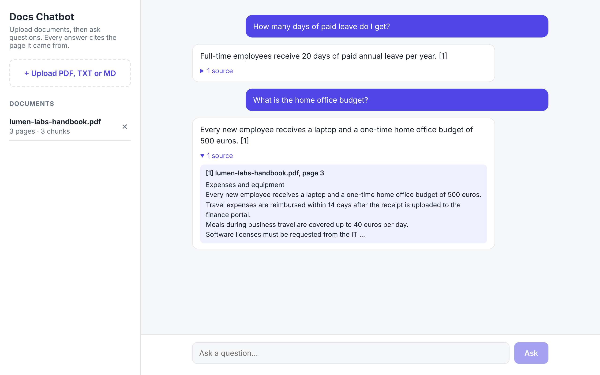

# RAG Docs Chatbot

Chat with your own documents. Upload PDFs, text or Markdown files, ask questions in plain language, and get answers that **cite the document and page they came from**. If the answer is not in your documents, the bot says so instead of guessing.



Built with **FastAPI**, **Google Gemini** (embeddings + chat), **NumPy** for vector search and a **React + TypeScript** front-end.

## Features

- Upload PDF, TXT and Markdown files (multiple at once)
- Answers grounded only in your documents, with numbered citations like `[1]`
- Expandable sources showing the exact passage, file name and page
- Replies in the language of the question
- Runs fully **offline** with a built-in fake provider (`LLM_PROVIDER=fake`), handy for demos and tests
- Persistent local index, so documents survive a restart
- Docker Compose setup and GitHub Actions CI

## How it works

```
Upload ──► extract text per page ──► split into overlapping chunks ──► embed ──► vector store
                                                                                    │
Question ──► embed ──► cosine search (top-k) ──► prompt with numbered sources ──► Gemini ──► answer + citations
```

1. **Extract** – `pypdf` reads text page by page, so every chunk remembers its page number.
2. **Chunk** – pages are split into ~900-character windows with 150 characters of overlap. Cuts prefer sentence ends, so facts are not split in half.
3. **Embed** – each chunk becomes a vector with `gemini-embedding-001` (document and query use separate task types for better retrieval).
4. **Retrieve** – the question is embedded and compared to every chunk with cosine similarity. The best `top_k` chunks above a minimum score are kept.
5. **Generate** – the model gets a strict system prompt: use only the numbered sources, cite them, and admit when the answer is missing.

The vector store is intentionally simple (NumPy + JSON files). It is fast for thousands of chunks and needs no infrastructure. It sits behind a small interface, so it can be replaced with Chroma, pgvector or Pinecone for larger collections. The same applies to the model provider: adding OpenAI or Claude means one new class in `providers.py`.

## Getting started

### 1. Backend

```bash
cd backend
python -m venv .venv
source .venv/bin/activate          # Windows: .venv\Scripts\activate
pip install -r requirements.txt
cp .env.example .env               # then paste your key into .env
uvicorn app.main:app --reload
```

Get a free Gemini API key at [Google AI Studio](https://aistudio.google.com/apikey). No key? Set `LLM_PROVIDER=fake` in `.env` to try everything offline.

### 2. Frontend

```bash
cd frontend
npm install
npm run dev
```

Open http://localhost:5173 and upload `sample_docs/lumen-labs-handbook.pdf` (a fictional company handbook) to try it.

### Docker

```bash
cp backend/.env.example backend/.env   # add your key
docker compose up --build
```

The app is served at http://localhost:8080.

## API

| Method | Path | Description |
| --- | --- | --- |
| `GET` | `/api/health` | Health check and active provider |
| `POST` | `/api/documents` | Upload a file (`multipart/form-data`, field `file`) |
| `GET` | `/api/documents` | List indexed documents |
| `DELETE` | `/api/documents/{id}` | Remove a document and its chunks |
| `POST` | `/api/chat` | `{"question": "..."}` → `{"answer": "...", "sources": [...]}` |

Interactive docs are available at http://localhost:8000/docs while the backend runs.

## Configuration

All settings can be set as environment variables or in `backend/.env`.

| Variable | Default | Meaning |
| --- | --- | --- |
| `LLM_PROVIDER` | `gemini` | `gemini` or `fake` (offline) |
| `GEMINI_API_KEY` | – | Your Gemini API key |
| `GEMINI_CHAT_MODEL` | `gemini-2.5-flash` | Model used to write answers |
| `GEMINI_EMBEDDING_MODEL` | `gemini-embedding-001` | Model used for embeddings |
| `CHUNK_SIZE` / `CHUNK_OVERLAP` | `900` / `150` | Chunk length and overlap in characters |
| `TOP_K` | `4` | Number of chunks sent to the model |
| `MIN_SCORE` | `0.2` | Minimum cosine similarity for a chunk to be used |
| `MAX_UPLOAD_MB` | `20` | Upload size limit |

## Tests

```bash
cd backend
pip install -r requirements-dev.txt
pytest
```

The tests run offline with the fake provider and cover PDF extraction, chunking, retrieval, persistence, the Gemini provider (with a mocked client) and the full upload → chat → delete API flow.

## Project structure

```
backend/
  app/
    main.py          FastAPI routes
    rag.py           Ingest and question-answering pipeline
    loaders.py       PDF / TXT / MD text extraction
    chunking.py      Overlapping, sentence-aware chunking
    providers.py     Gemini + offline fake embedding/chat providers
    vector_store.py  NumPy cosine search with JSON persistence
    prompts.py       Grounded-answer system prompt
    config.py        Settings from environment
  tests/
frontend/
  src/App.tsx        Chat UI, uploads, sources
  src/api.ts         Typed API client
sample_docs/         Fictional handbook used for demos and tests
```

## Limitations and next steps

- Scanned PDFs have no text layer and need OCR before upload.
- Brute-force search is ideal up to tens of thousands of chunks; beyond that, use a vector database.
- Ideas: streaming responses, chat history for follow-up questions, hybrid keyword + vector search, and authentication for multi-user use.

## License

MIT
